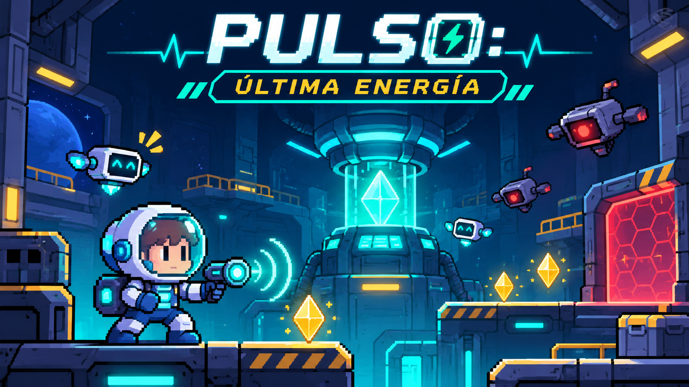
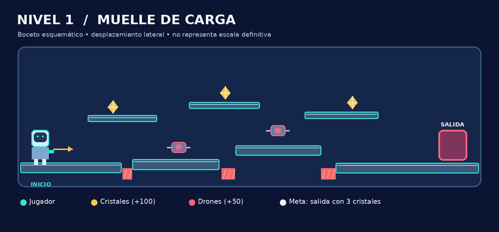

# ⚡ PULSO: Última Energía



> **Estado verificado el 11 de noviembre de 2026:** videojuego implementado localmente y sometido a pruebas de lógica e interfaz. **Publicación en GitHub Pages pendiente; no afirmar que la URL funciona hasta verificarla públicamente.**

**Propuesta y concepto:** José Ramón Ibarra · **Género:** plataformas 2D / acción ligera · **Tecnología:** HTML5 + CSS3 + JavaScript ES Modules + Canvas 2D + Web Audio API (sin motor, backend ni dependencias de ejecución).

## Propuesta individual

La estación espacial NÉBULA está perdiendo energía. Axel, acompañado del robot BIP, debe recuperar cristales, desactivar drones averiados con un pulso de energía y abrir las compuertas antes de que se agote el tiempo. Es un videojuego indie de estética pixel art simplificada para jugadores casuales desde 10 años, creado como caso práctico escolar. El juego no contiene violencia gráfica.

### Objetivos de aprendizaje

- Programar entradas de teclado y botones táctiles, movimiento, gravedad y colisiones.
- Implementar eventos, sprites dibujados en Canvas 2D, enemigos, coleccionables y un temporizador.
- Calcular puntuación reproducible y evitar eventos duplicados.
- Generar sonido y melodías originales con Web Audio API, con control de silencio.
- Documentar el desarrollo usando GDD, Git, Issues y publicación web.

## Jugar

- **Juego en línea (pendiente de verificar/publicar):** `https://ramonibr.github.io/pulso-ultima-energia/`
- **Repositorio (pendiente de crear/publicar):** `https://github.com/ramonibr/pulso-ultima-energia`
- **Local:** abrir esta carpeta en un terminal y ejecutar `python3 -m http.server 8080`, luego visitar `http://localhost:8080/`. Se requiere servir los módulos ES por HTTP, no abrir `index.html` mediante `file://`.

### Controles

| Acción | Teclado | Móvil / pantalla táctil |
| --- | --- | --- |
| Mover | A/D o ←/→ | Botones ◀ y ▶ |
| Saltar | W o ↑ | Botón ↑ Saltar |
| Emitir pulso | Espacio | Botón ⚡ Pulso |
| Pausar / reanudar | P o Esc | Botón superior Pausa |
| Sonido | Botón superior | Botón superior |

**Reglas:** empieza con 3 vidas. Cada cristal se recoge una vez. Al recuperar todos los cristales del sector, se abre la puerta. El escudo absorbe un golpe sin quitar vida ni puntos. Los drones se pueden desactivar. El tiempo o vidas agotadas terminan la partida. La puntuación final se muestra al concluir los tres sectores.

## Niveles incluidos

| Nivel | Ubicación | Cristales | Drones | Tiempo |
| --- | --- | ---: | ---: | ---: |
| 1 | Muelle de Carga | 3 | 2 | 90 s |
| 2 | Conductos Eléctricos | 4 | 3 | 80 s |
| 3 | Cámara del Núcleo | 5 | 4 | 70 s |



## Fórmula de puntuación

| Evento | Puntos |
| --- | ---: |
| Cristal recogido por primera vez | +100 |
| Dron desactivado por primera vez | +50 |
| Finalizar un nivel | +200 |
| Bono por tiempo | +2 por segundo entero restante al finalizar |
| Impacto que consume vida | −25 |

`SCORE = max(0, 100*C + 50*D + 200*N + 2*T - 25*H)`.

C = cristales únicos; D = drones únicos desactivados; N = niveles completos; T = suma de segundos enteros restantes al terminar cada nivel; H = impactos efectivos. Los identificadores de evento evitan registrar dos veces la misma gema, enemigo o nivel. Ejemplo: 3 gemas + 2 drones + 1 nivel + 40 segundos − 1 daño = `300 + 100 + 200 + 80 − 25 = 655 puntos`.

## Organización del código

```text
index.html             Entrada del juego y HUD
styles.css             Interfaz adaptable y controles
src/game.js            Bucle Canvas, físicas, colisiones, estados, eventos
src/levels.js          Datos y validación de los tres niveles
src/audio.js           Música ambiental y efectos originales sintetizados
src/scoring.js         Eventos únicos y cálculo de puntos
tests/game.test.js     Pruebas automatizadas con Node.js
docs/                  Propuesta, GDD, técnico, storyboard, tarjetas y guion
assets/                Splash, mapa y arte visual
```

## Pruebas y publicación

**Requisitos de pruebas:** Node.js 18 o superior y navegador moderno. El juego en producción no necesita Node ni instalación de paquetes.

```bash
npm run check
npm test
python3 -m http.server 8080
```

Se han ejecutado cinco pruebas automatizadas correctas sobre niveles y puntaje; además, se verificaron visualmente menú, partida y pausa en Chromium mediante una versión de inspección con módulos reunidos, sin errores de JavaScript. Falta confirmar el recorrido manual completo, las pruebas en GitHub Pages y los controles en dispositivos reales. Ver [`docs/EVIDENCIAS_QA.md`](docs/EVIDENCIAS_QA.md).

**GitHub Pages:** después de subir los archivos a la rama `main`, entrar en `Settings → Pages → Build and deployment → Deploy from a branch → main → /(root) → Save`; confirmar la URL desde otro navegador. GitHub documenta esta publicación estática en <https://docs.github.com/en/pages/getting-started-with-github-pages/configuring-a-publishing-source-for-your-github-pages-site>.

## Documentación del proyecto

- [Propuesta individual](docs/PROPUESTA_INDIVIDUAL.md) · [versión Word](docs/PROPUESTA_INDIVIDUAL.docx)
- [Documento de Diseño de Juego — GDD](docs/GDD.md) · [versión Word](docs/GDD.docx)
- [Documento técnico de hardware y software](docs/DOCUMENTO_TECNICO.md) · [versión Word](docs/DOCUMENTO_TECNICO.docx)
- [Storyboard y mapa](assets/storyboard.png)
- [Tarjetas de trabajo e Issues](docs/TARJETAS_GITHUB.md)
- [Guion para el video explicativo](docs/GUION_VIDEO.md)
- [Evidencias de pruebas](docs/EVIDENCIAS_QA.md)

## Créditos y derechos

Concepto del juego: **José Ramón Ibarra**. Integrantes adicionales y fotografías de la portada: **por completar únicamente con datos y fotos reales autorizados**. Programación y materiales preparados con asistencia técnica de herramientas de IA; revisar y comprender el trabajo antes de presentarlo. Arte de splash generado para este concepto; diseños, efectos y melodías originales sintetizados. No se incorporaron recursos musicales comerciales.

## Fuentes técnicas

[MDN Canvas 2D](https://developer.mozilla.org/es/docs/Web/API/Canvas_API) · [MDN Web Audio API](https://developer.mozilla.org/en-US/docs/Web/API/Web_Audio_API) · [GitHub Pages](https://docs.github.com/en/pages/getting-started-with-github-pages/creating-a-github-pages-site) · [GitHub CLI](https://cli.github.com/manual/gh_repo_create)
