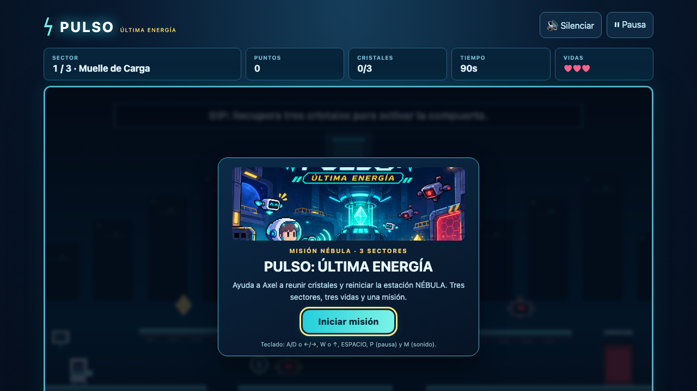
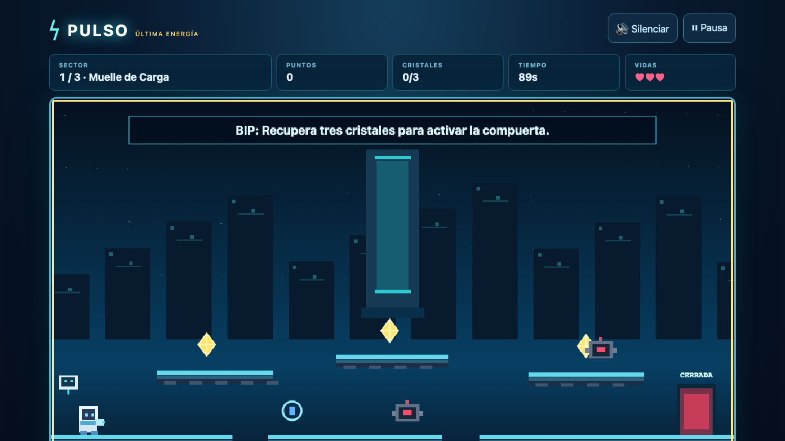
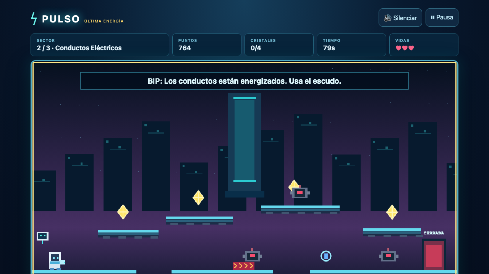
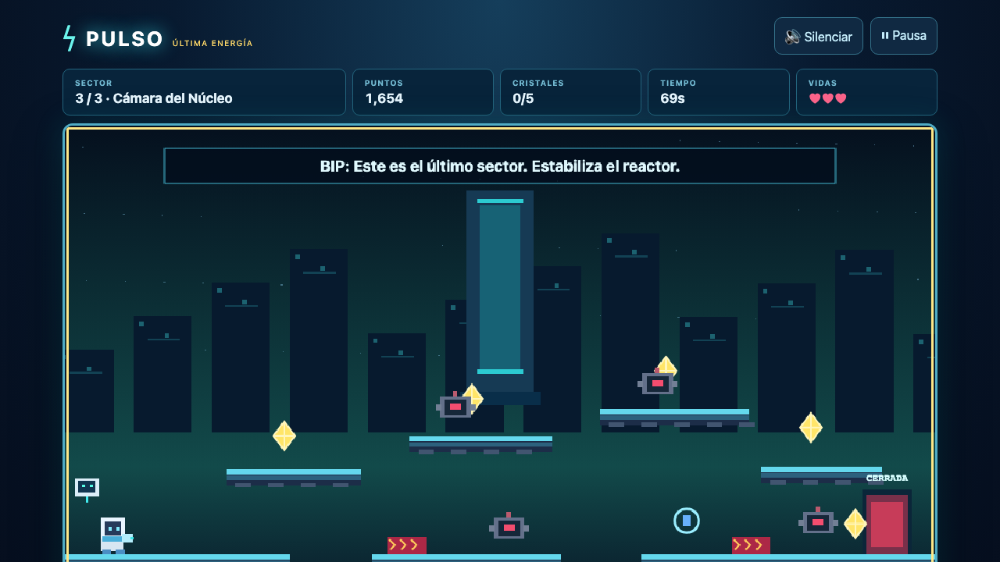
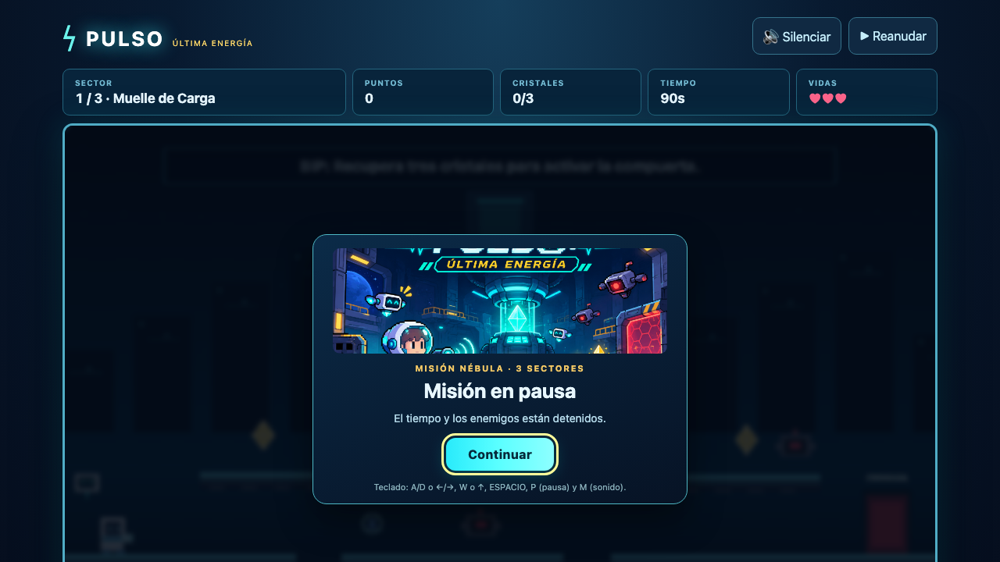
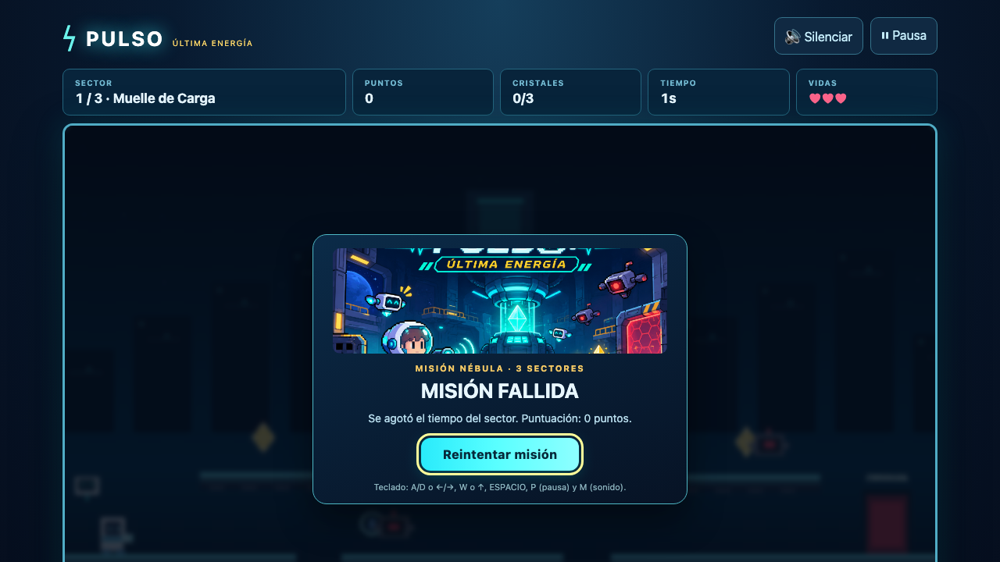
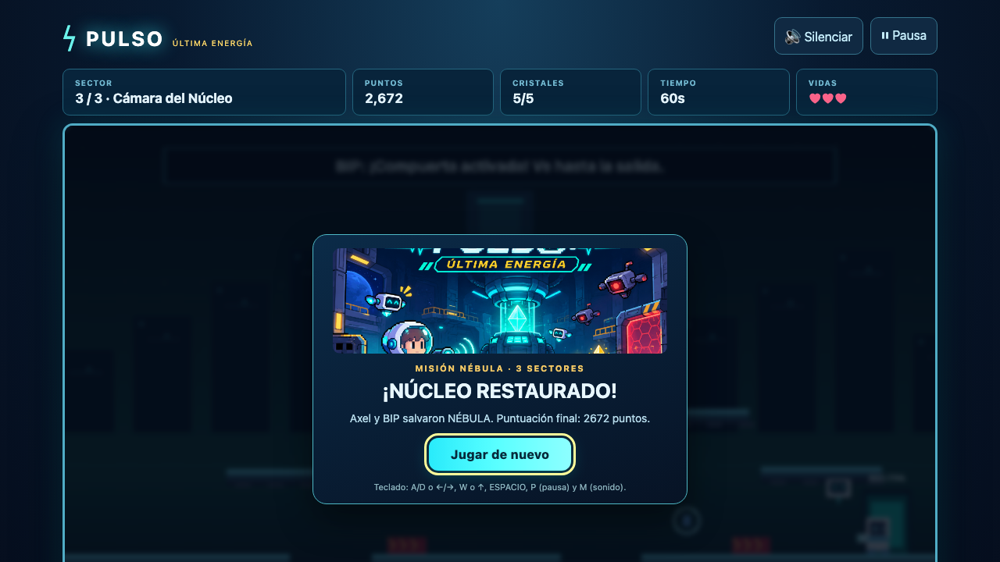
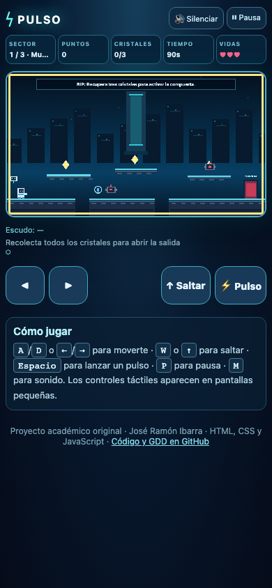

# Evidencias de QA — 11 de noviembre de 2026

Pruebas ejecutadas en macOS con Node.js 25.9 y Playwright 1.65 (Chromium y WebKit/Safari). Todas las pruebas de navegador sirven el juego por HTTP.

## 1. Pruebas unitarias y de sintaxis

| Comando | Qué valida | Resultado |
| --- | --- | --- |
| `npm run check` | Sintaxis de `src/*.js` y `tests/e2e/*.js` | PASS |
| `npm test` | 3 niveles con 3/4/5 cristales, 2/3/4 drones, 90/80/70 s | PASS |
| `npm test` | Fórmula: 100+50+200+2·43−25 con 43,9 s → 411 | PASS |
| `npm test` | Evento repetido no se cuenta dos veces | PASS |
| `npm test` | Puntuación nunca negativa | PASS |
| `npm test` | Eventos inválidos se ignoran | PASS |

## 2. Pruebas E2E en navegador (`npm run test:e2e`)

El reloj del navegador se controla con `page.clock` (avanza `requestAnimationFrame` en pasos de 16 ms) para obtener partidas reproducibles. Toda la entrada es **teclado o puntero reales**; el estado del juego (`window.pulso_game`) solo se **lee**.

| # | Prueba | Chromium | WebKit |
| --- | --- | --- | --- |
| 1 | Carga sin errores JS ni recursos 4xx; pantalla de inicio | PASS | PASS |
| 2 | **Partida completa de los 3 niveles solo con teclado** (12 cristales, 9 drones, victoria) | PASS | PASS |
| 3 | Movimiento (D, ←), salto con gravedad, aterrizaje, disparo, cristal contado una vez, HUD 150 pts | PASS | PASS |
| 4 | Escudo absorbe caída (3 vidas, 0 impactos); siguiente caída: 2 vidas, −25 pts | PASS | PASS |
| 5 | Pausa con P congela el temporizador 5 s; reanudar; M alterna silencio | PASS | PASS |
| 6 | Derrota por tiempo (91 s) y reintento con 3 vidas | PASS | PASS |
| 7 | Derrota por perder 3 vidas | PASS | PASS |
| 8 | Móvil 390×844: controles táctiles visibles, sin scroll horizontal, ◀▶ y Saltar funcionan | PASS | PASS |

Total: **16/16 PASS** en local, repetido en varias corridas con resultado idéntico: victoria con **2672 puntos** = 100·12 + 50·9 + 200·3 + 2·211 − 25·0 (3 vidas, 0 impactos, 211 segundos de bono).

### Cómo se juega la partida automática (sin teletransporte)

`tests/e2e/bot.js` define una ruta por nivel con acciones de jugador: `walk_to(x)` mantiene A/D, `jump_to(x)` pulsa W y dirige en el aire, `face(dir)` gira, y `wait_until(...)` espera (opcionalmente saltando) mientras dispara con Espacio a drones alineados. Ejemplo nivel 1: eliminar dron del suelo → saltar a la plataforma A (cristal 1) → plataforma B (cristal 2) → disparar al dron de la plataforma C → saltar a C (cristal 3) → bajar a la salida.

## 3. Verificación de GitHub Pages

URL: <https://ramonibr.github.io/pulso-ultima-energia/> (fuente `main`, `/(root)`).

| Recurso | HTTP |
| --- | --- |
| `/` e `index.html` | 200 |
| `styles.css` | 200 |
| `src/game.js`, `src/levels.js`, `src/scoring.js`, `src/audio.js` | 200 |
| `assets/splash.png`, `assets/favicon.svg` | 200 |

Suite E2E completa ejecutada **contra la URL pública** (`PULSO_URL=… npm run test:e2e`): **16/16 PASS**; la partida automática ganó los 3 niveles en ambos navegadores con 2672 puntos.

## 4. Errores encontrados y corregidos

| Error | Corrección |
| --- | --- |
| La tecla **M** no silenciaba (solo el botón) | `toggleSound()` compartido por tecla M y botón |
| Caer al vacío con escudo activo: el escudo absorbía el golpe pero Axel seguía cayendo fuera de pantalla hasta perder una vida | Tras una caída siempre reaparece en el inicio del sector |

## 5. Capturas reales (generadas con `npm run capturas`)

| Inicio | Nivel 1 | Nivel 2 | Nivel 3 |
| --- | --- | --- | --- |
|  |  |  |  |
| **Pausa** | **Derrota** | **Victoria** | **Móvil** |
|  |  |  |  |

## 6. Límites y pendientes reales

- No se escuchó el audio: se verificó que M y el botón cambian el estado de silencio, no la salida de sonido. Recomendado: escucharlo una vez en Safari/Chrome.
- Las pruebas táctiles usan un puntero emulado en Chromium/WebKit; no se probó en un teléfono físico.
- Se recomienda una partida manual del autor antes de grabar el video (sirve también como ensayo).
