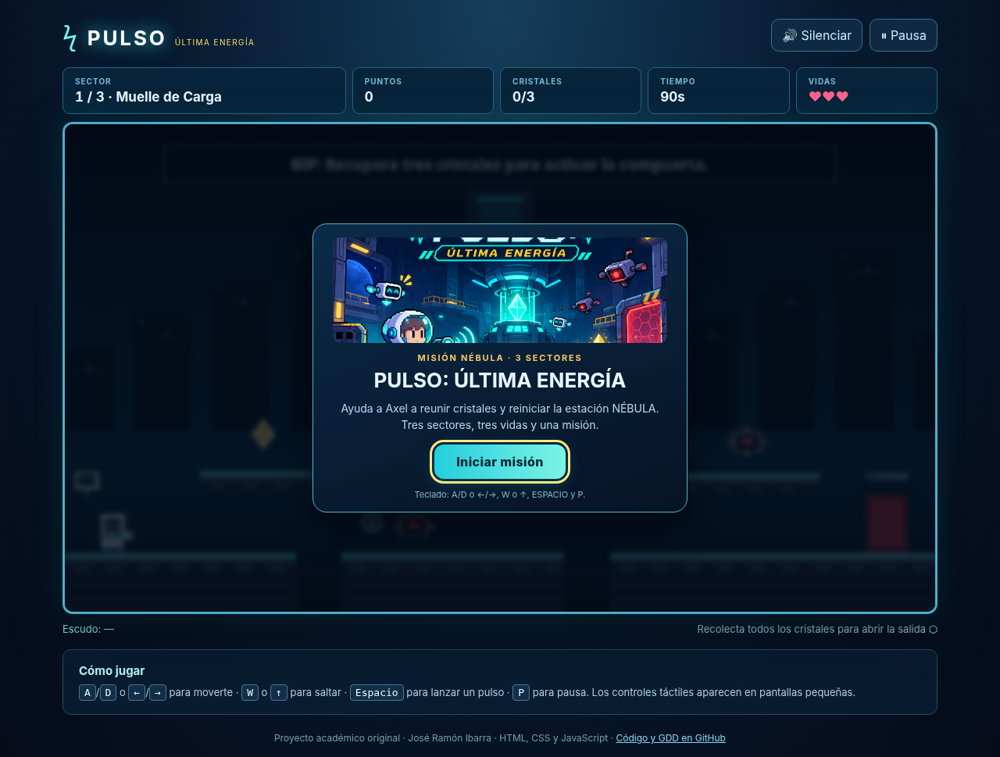
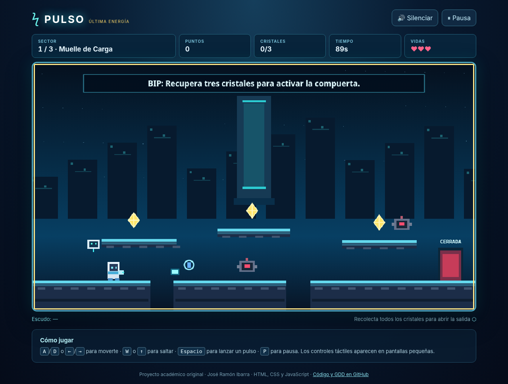
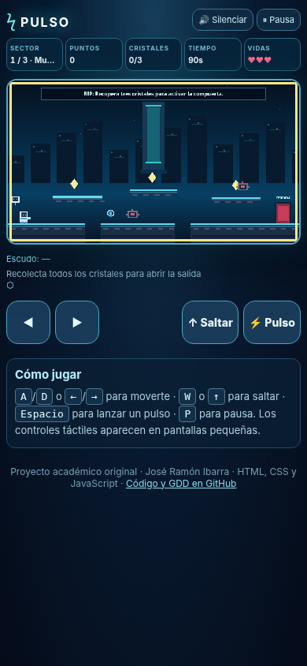

# Evidencias técnicas y pruebas — 11 de noviembre de 2026

## Verificación ejecutada en entorno local

| Prueba | Evidencia | Resultado |
| --- | --- | --- |
| Sintaxis de módulos JavaScript | `npm run check` | PASS |
| Tres niveles y progresión 3/4/5 cristales | `npm test` | PASS |
| Fórmula de puntos | `npm test` | PASS |
| Protección frente a eventos repetidos | `npm test` | PASS |
| Score no negativo | `npm test` | PASS |
| Rechazo de evento inválido | `npm test` | PASS |
| Render de pantalla inicial | Chromium, HTML/CSS y módulos cargados en memoria desde las mismas fuentes | PASS |
| Iniciar partida y avanzar reloj | Chromium, mismo método | PASS |
| Pausar y reanudar | Chromium, mismo método | PASS |
| Errores JavaScript al iniciar y pausar | Chromium | 0 errores de página |

## Capturas de la interfaz

## Pruebas restantes antes de la entrega final

- [ ] Abrir desde un servidor HTTP local y completar manualmente los tres sectores sin herramientas de QA.
- [ ] Revisar salto, disparo, impacto y escudo en teclado real.
- [ ] Probar en teléfono o vista táctil y verificar la posición de controles.
- [ ] Crear o verificar el repositorio público real.
- [ ] Configurar GitHub Pages, abrir la URL pública y confirmar HTTP 200 y recursos correctos.
- [ ] Grabar video explicativo con voz del alumno mostrando código, controles y puntuación.
- [ ] Agregar fotografías autorizadas e integrantes reales a la portada.

**Nota:** estas pruebas no acreditan todavía la publicación pública ni la jugabilidad completa sin fallos; se deben completar y documentar esos puntos antes de marcarlos como terminados.

## Prueba adicional de flujo automatizado de los tres sectores

Se ejecutó una prueba de integración de estados en Chromium instrumentando una copia en memoria de los módulos: recolección de 12 cristales, desactivación de 9 drones, transición 1 → 2 → 3, y pantalla final «¡NÚCLEO RESTAURADO!». El score reportado fue **2724 puntos** en esa ejecución sintética (incluye bonificaciones por tiempo). Esta prueba **inyecta posiciones de juego directamente**, por lo tanto **no reemplaza una partida manual ni demuestra por sí sola que todos los saltos sean alcanzables**.

Se verificó también que los controles táctiles aparezcan en vista de 390 px. Captura:

