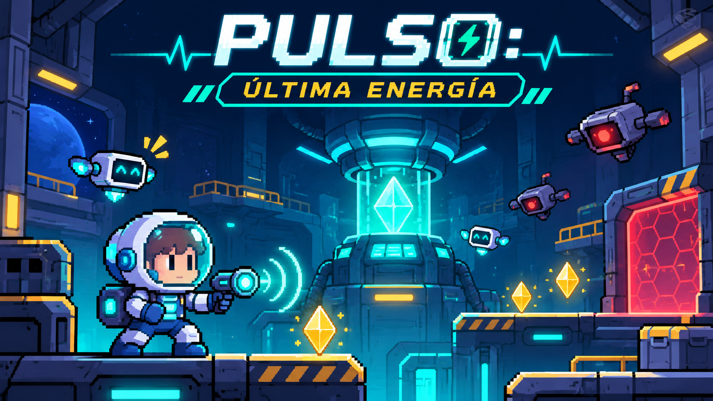
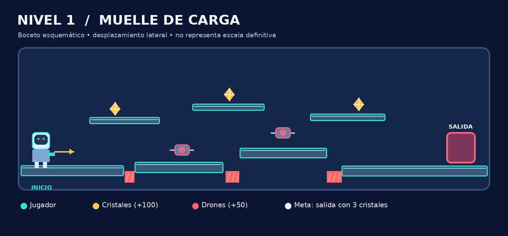
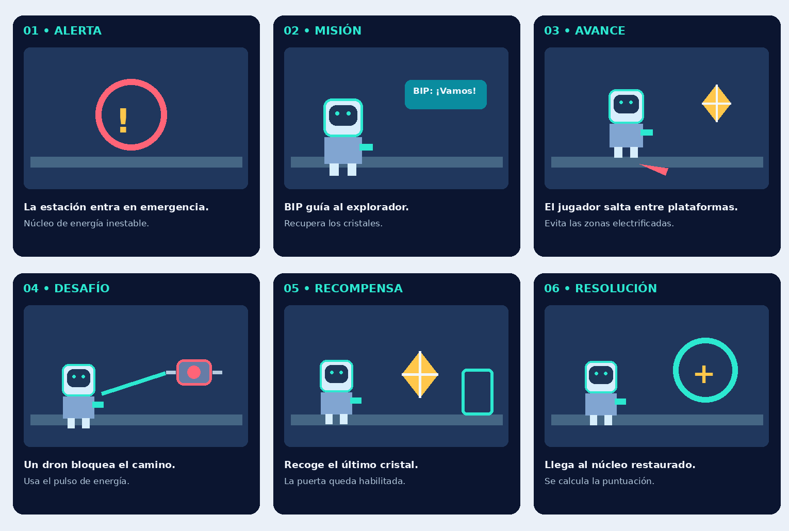

# Documento de Diseño de Juego (GDD)

## 1. Portada

# PULSO: Última Energía

**Documento de Diseño de Juego — versión 2.0**
**Fecha:** 11 de noviembre de 2026 · **Entrega:** 12 de noviembre de 2026
**Autor del concepto:** José Ramón Ibarra
**Materia / docente / grupo:** _por completar_

## 2. Integrantes

| # | Fotografía | Nombre completo | Rol en el proyecto |
| --- | --- | --- | --- |
| 1 | _[Espacio para fotografía]_ | José Ramón Ibarra | Concepto, programación, documentación |
| 2 | _[Espacio para fotografía]_ | _[Nombre del integrante 2]_ | _[Rol]_ |
| 3 | _[Espacio para fotografía]_ | _[Nombre del integrante 3]_ | _[Rol]_ |
| 4 | _[Espacio para fotografía]_ | _[Nombre del integrante 4]_ | _[Rol]_ |

> Completar únicamente con nombres y fotografías reales y autorizadas. Si el trabajo es individual, eliminar las filas 2–4.

## 3. Nombre e imagen splash del juego

**Nombre:** PULSO: Última Energía



## 4. URL del repositorio y del juego

- **Repositorio:** <https://github.com/ramonibr/pulso-ultima-energia>
- **Juego (GitHub Pages, verificado HTTP 200 el 11/11/2026):** <https://ramonibr.github.io/pulso-ultima-energia/>
- **Tablero Kanban:** <https://github.com/users/ramonibr/projects/9>

## 5. Género

Plataformas 2D con aventura y acción ligera (recolección, disparo, contrarreloj).

## 6. Público objetivo

Jugadores casuales desde 10 años, en navegador de escritorio o móvil. Partidas cortas (máximo 4 minutos), reglas simples y sin violencia gráfica: los drones solo se desactivan.

## 7. Historia

La estación espacial **NÉBULA** perdió el control de su núcleo energético. Los drones de mantenimiento quedaron defectuosos y atacan todo lo que se mueve, y los conductos están electrificados. **Axel**, explorador con traje de rescate, es el último miembro de la tripulación capaz de llegar al núcleo. Con la guía de **BIP**, su acompañante robótico, debe atravesar tres sectores, recuperar los cristales de energía de reserva y reiniciar el reactor antes de que la estación se apague.

## 8. Personajes

| Personaje | Rol | Aspecto | Comportamiento en el juego |
| --- | --- | --- | --- |
| **Axel** | Protagonista | Traje de rescate blanco y azul, casco con visor oscuro y ojos cian, emisor de pulsos en el brazo | Corre, salta, dispara pulsos, recoge cristales y escudo |
| **BIP** | Acompañante robótico | Pequeño robot flotante blanco con pantalla y ojos turquesa | Sigue a Axel y explica la misión con mensajes en pantalla |
| **Dron defectuoso** | Enemigo | Robot gris con núcleo rojo y antena | Patrulla de lado a lado; su contacto quita una vida |
| **Núcleo NÉBULA** | Objetivo | Reactor cilíndrico con brillo cian pulsante | Fondo de cada sector; se estabiliza al ganar |

## 9. Niveles

| Nivel | Nombre | Cristales | Drones | Tiempo | Diseño |
| --- | --- | ---: | ---: | ---: | --- |
| 1 | Muelle de Carga | 3 | 2 | 90 s | Suelo con dos huecos y tres plataformas en escalera; un dron en el suelo y otro en la última plataforma. Escudo en el suelo. Nivel de aprendizaje. |
| 2 | Conductos Eléctricos | 4 | 3 | 80 s | Cuatro plataformas ascendentes, zona eléctrica en el suelo central, dron en la plataforma más alta (se elimina saltando y disparando) y dron junto a la salida. |
| 3 | Cámara del Núcleo | 5 | 4 | 70 s | Huecos más anchos, dos zonas eléctricas, drones en dos plataformas altas y uno patrullando frente a la salida; el último cristal está junto a la compuerta. |

En todos los niveles la **compuerta de salida está CERRADA (roja)** hasta recoger todos los cristales; entonces cambia a **SALIDA (turquesa)**. Los tres niveles se superaron con controles normales en la prueba E2E (ver `docs/EVIDENCIAS_QA.md`).

## 10. Mapa bocetado del primer nivel



Esquema implementado (coordenadas del lienzo 960 × 540):

```text
 y≈360            [B: cristal 2]
 y≈385   [A: cristal 1]          [C: cristal 3 + dron 2]
 y=475 ███████████  ··  ███████████████  ··  ███████████████████ [SALIDA]
       Axel          hueco   escudo  dron 1   hueco
       x=0      255  305                 550  602            884
```

## 11. Armas

**Emisor de pulsos:** dispara un proyectil de energía cian en la dirección en que mira Axel (alcance ≈ 400 px, recarga 0,4 s). Desactiva un dron por impacto (+50 puntos). No hay munición limitada.

## 12. Vestimenta

Traje de rescate espacial blanco con franja azul, casco con visor oscuro, botas azules y el emisor de pulsos montado en el brazo derecho. Al recoger el escudo aparece un halo cian alrededor del traje.

## 13. Objetos especiales

| Objeto | Efecto |
| --- | --- |
| Cristal de energía (amarillo) | +100 puntos; todos los del sector abren la salida |
| Escudo temporal (anillo azul) | Absorbe el siguiente golpe sin quitar vida ni puntos; da 1 s de invulnerabilidad |
| Compuerta de salida | Termina el sector cuando está abierta |
| Zona eléctrica (roja con rayos) | Quita una vida al tocarla |

## 14. Escenarios y fondos

Cielo estelar, siluetas de torres industriales con luces turquesa y el reactor central pulsante. Cada sector tiene un tinte propio: azul profundo (Muelle de Carga), violeta (Conductos Eléctricos) y verde azulado (Cámara del Núcleo). Las plataformas son pasarelas metálicas con borde turquesa.

## 15. Storyboard (seis escenas)



| Escena | Imagen | Texto / acción |
| --- | --- | --- |
| 1. Emergencia | Estación NÉBULA a oscuras, reactor parpadeando | Pantalla de inicio: «Ayuda a Axel a reunir cristales y reiniciar la estación NÉBULA». |
| 2. La misión | Axel y BIP en el Muelle de Carga | BIP: «Recupera tres cristales para activar la compuerta». |
| 3. Exploración | Axel salta entre plataformas y recoge un cristal | HUD: «Cristal recuperado: 1/3». |
| 4. Encuentro con dron | Axel dispara un pulso a un dron | «Dron desactivado: +50 puntos». |
| 5. Último cristal | La puerta pasa de roja a turquesa | BIP: «¡Compuerta activada! Ve hasta la salida». |
| 6. Núcleo restaurado | Pantalla final con puntuación | «¡NÚCLEO RESTAURADO! Axel y BIP salvaron NÉBULA». |

## 16. Guion narrativo

- **Inicio:** «PULSO: ÚLTIMA ENERGÍA. Ayuda a Axel a reunir cristales y reiniciar la estación NÉBULA. Tres sectores, tres vidas y una misión.»
- **Sector 1 — BIP:** «Recupera tres cristales para activar la compuerta.»
- **Sector 2 — BIP:** «Los conductos están energizados. Usa el escudo.»
- **Sector 3 — BIP:** «Este es el último sector. Estabiliza el reactor.»
- **Escudo — BIP:** «¡El escudo absorbió el golpe!»
- **Todos los cristales — BIP:** «¡Compuerta activada! Ve hasta la salida.»
- **Sector superado:** «SECTOR N COMPLETADO. Cristales recuperados. Bono de tiempo: X puntos.»
- **Victoria:** «¡NÚCLEO RESTAURADO! Axel y BIP salvaron NÉBULA.»
- **Derrota:** «MISIÓN FALLIDA. Axel se quedó sin vidas / Se agotó el tiempo del sector.»

## 17. Música (por nivel)

Música original sintetizada en tiempo real con Web Audio API (onda triangular, volumen bajo, una nota cada 0,54 s ≈ 111 pulsos por minuto):

| Nivel | Secuencia (Hz) | Carácter |
| --- | --- | --- |
| 1 | 196, 247, 294, 247, 220, 294, 247, 196 (sol mayor) | Tranquilo, de aprendizaje |
| 2 | 174, 220, 261, 220, 196, 261, 220, 174 (fa mayor) | Más grave y tenso |
| 3 | 164, 246, 294, 329, 294, 246, 220, 196 (mi menor) | Ascendente, clímax |

## 18. Efectos de audio

| Evento | Sonido sintetizado |
| --- | --- |
| Salto | Dos tonos triangulares ascendentes |
| Pulso | Diente de sierra grave + tono agudo |
| Cristal | Dos tonos senoidales brillantes (660 → 990 Hz) |
| Impacto | Diente de sierra grave de 0,22 s |
| Escudo | Tono triangular + senoidal |
| Dron desactivado | Onda cuadrada que desciende |
| Compuerta abierta | Dos tonos senoidales ascendentes |
| Victoria de sector | Arpegio do–mi–sol |

Tecla **M** o botón 🔊 activan/desactivan todo el audio. El audio se inicia tras el primer gesto del usuario (política de autoplay de los navegadores).

## 19. Plan de trabajo

| Fase | Entregables | Estado |
| --- | --- | --- |
| 1. Preproducción | Propuesta, GDD, requerimientos, tablero | Hecho (faltan integrantes/fotos) |
| 2. Prototipo | Movimiento, salto, colisiones, bucle de juego | Hecho |
| 3. Mecánicas | Drones, disparo, cristales, escudo, vidas, tiempo, puntuación | Hecho |
| 4. Contenido | 3 niveles, audio, HUD, pantallas de estado, controles táctiles | Hecho |
| 5. Calidad | Pruebas unitarias y E2E, correcciones | Hecho |
| 6. Entrega | GitHub Pages, documentación, video | Pages y docs hechos; video pendiente (12/11/2026) |

Seguimiento en el tablero: <https://github.com/users/ramonibr/projects/9> (columnas Pendiente, En curso, En revisión, Hecho).

## 20. Estrategia Git

- Rama `main` siempre estable; GitHub Pages publica desde `main` / `(root)`.
- Ramas cortas `feature/<tema>` o `fix/<tema>` para cambios y pull request antes de integrar (en equipo).
- Commits convencionales: `feat(game): …`, `fix: …`, `test: …`, `docs: …`.
- Un Issue por tarea con criterios de aceptación; el commit o PR referencia el Issue.
- `.gitignore` excluye `node_modules/`, reportes de pruebas y cualquier `.env`, llave o credencial.

## 21. Puntuación y fórmula

```
score = max(0, 100*C + 50*D + 200*N + 2*T - 25*H)
```

| Variable | Significado | Puntos |
| --- | --- | ---: |
| C | Cristales recogidos | +100 c/u |
| D | Drones desactivados | +50 c/u |
| N | Niveles completados | +200 c/u |
| T | Suma de segundos enteros restantes al terminar cada nivel | +2 c/u |
| H | Impactos recibidos que quitaron vida | −25 c/u |

Cada evento se registra una sola vez mediante un identificador único. El escudo absorbe el daño sin restar vida ni puntos. Ejemplo: 3 cristales, 2 drones, 1 nivel, 40 s, 1 impacto → 300 + 100 + 200 + 80 − 25 = **655**.

## 22. Créditos

- **Concepto y dirección:** José Ramón Ibarra.
- **Integrantes adicionales:** _por completar_.
- **Programación y documentación:** José Ramón Ibarra, con apoyo de herramientas de IA, revisada por el autor.
- **Arte:** gráficos del juego dibujados por código en Canvas 2D; splash, storyboard y mapa generados para este proyecto.
- **Música y efectos:** originales, sintetizados con Web Audio API.
- **Fuentes técnicas:** [MDN Canvas API](https://developer.mozilla.org/es/docs/Web/API/Canvas_API), [MDN Web Audio API](https://developer.mozilla.org/en-US/docs/Web/API/Web_Audio_API), [MDN requestAnimationFrame](https://developer.mozilla.org/en-US/docs/Web/API/Window/requestAnimationFrame), [GitHub Pages](https://docs.github.com/en/pages), [GitHub Projects](https://docs.github.com/en/issues/planning-and-tracking-with-projects).
